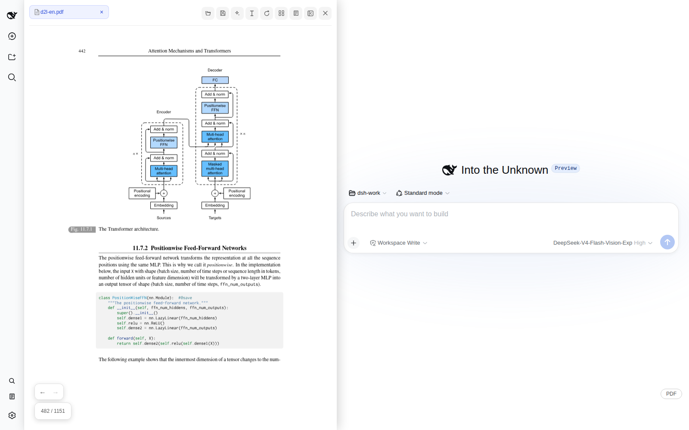
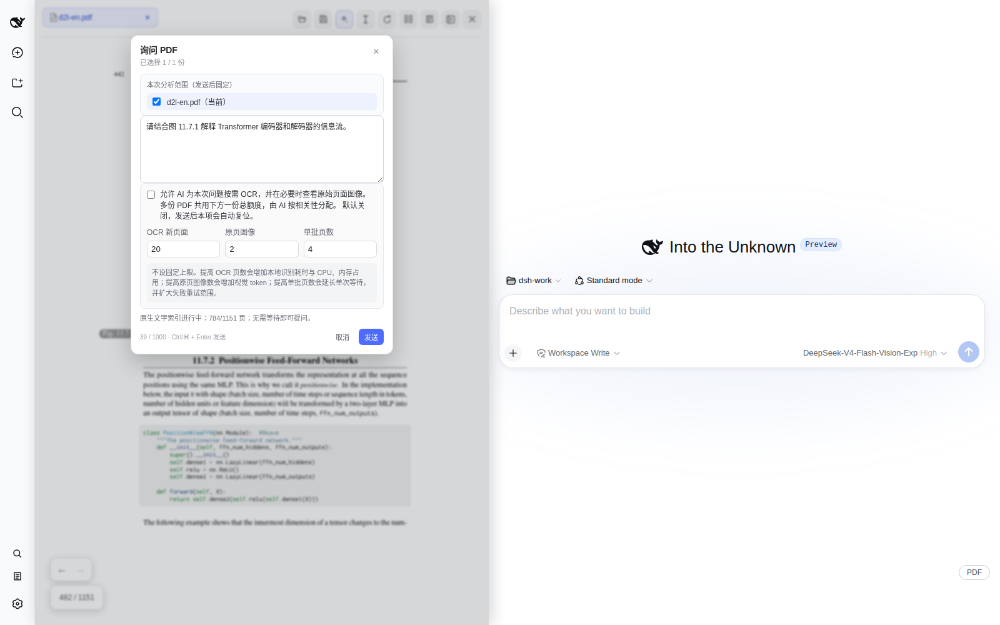
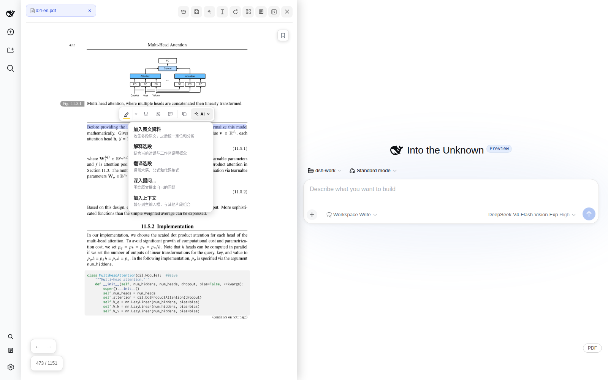
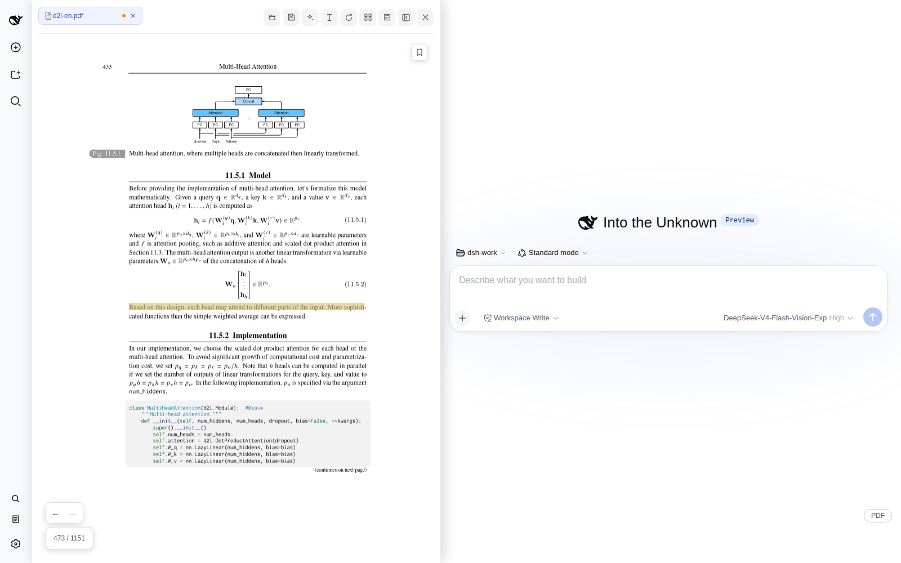
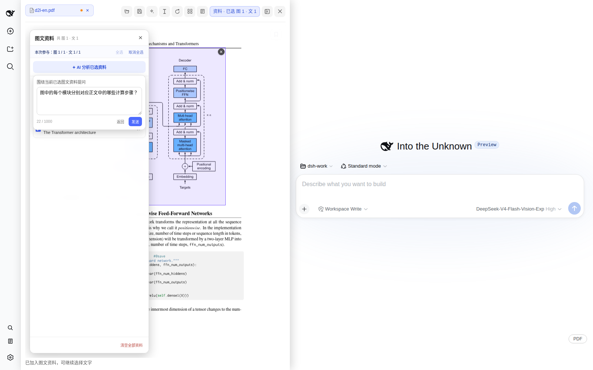

# dsh-pdf-reader

[简体中文](README.md) | English

An out-of-tree PDF reader plugin for DeepSeek Harness that brings reading, annotation, and AI analysis into the same web workflow. It supports native text, image regions, mixed image-text evidence, multi-PDF questions, and user-authorized on-demand OCR.

> **Release status: Beta.** This version targets DeepSeek Harness `0.2.2-alpha.2`. Test save operations on non-critical copies of your PDFs first.

<p align="center">
  
</p>

<p align="center"><sub>Read technical documents beside the conversation while pages, annotations, mixed evidence, and AI stay in one workflow.</sub></p>

## From reading to AI analysis

All demonstrations below use the open textbook [Dive into Deep Learning](https://d2l.ai/d2l-en.pdf).

### Ask about entire PDFs

Select one or more PDFs and ask a question directly. OCR is disabled by default and can inspect a small set of relevant pages only after the user authorizes it.



### Select text and use AI

Select text to copy, explain, translate, ask a deeper question, or add it to the conversation context and mixed evidence collection.



### Create and save annotations

Highlights, underlines, strikethroughs, and comments are supported. Changes are written to a PDF only when the user chooses **Save As** or confirms **Overwrite Original**.



### Combine figures with source text

Add diagrams, captions, and related paragraphs to a shared mixed evidence collection, analyze them together, and follow source links in the response back to the original page.



### Demo material and licensing

The textbook content shown in the screenshots comes from *Dive into Deep Learning* by Aston Zhang, Zachary C. Lipton, Mu Li, and Alexander J. Smola ([website](https://d2l.ai/) / [PDF](https://d2l.ai/d2l-en.pdf) / [source and license](https://github.com/d2l-ai/d2l-en/blob/master/LICENSE)) and is licensed under [CC BY-SA 4.0](https://creativecommons.org/licenses/by-sa/4.0/). This repository does not distribute the textbook PDF. Demo screenshots under `docs/images/readme/` that contain textbook pages are shared with attribution under CC BY-SA 4.0; the plugin source and interface code that does not contain textbook material remain under the MIT License.

## Core capabilities

- **Reading and navigation:** multi-PDF tabs, outlines, bookmarks, thumbnails, full-text search, navigation history, zoom, fit modes, and non-destructive rotation
- **Text and annotations:** native text selection, copy and AI actions, highlights, underlines, strikethroughs, comments, and an annotation center
- **Word pick and quick translation:** double-click a word to select it and open the reading menu; the menu's translate button returns a dictionary line from the default model in place, without writing a conversation turn
- **Multimodal AI:** image-region questions, a mixed evidence collection, evidence shared across PDFs, combined analysis, and clickable links back to sources
- **Whole-document questions:** ask across one or more PDFs while fixing the document scope for the request and distinguishing sourced facts from inferences
- **On-demand OCR:** disabled by default; after explicit user authorization, AI selects only the necessary pages within configurable budgets and never scans the whole document automatically
- **Save and restore:** restore open documents and reading state per conversation, save a copy, or overwrite the original after confirmation
- **Long-document resource control:** bounded or lazy handling for pages, canvases, thumbnails, and indexes, with an OCR page cache limited to about 64 MiB or 512 pages

See [src/README.md](src/README.md) for the source layout.

## Requirements

- DeepSeek Harness `0.2.2-alpha.2`
- Node.js `>=24.9.0`
- pnpm `>=11.28.5`
- A modern Chromium browser with IndexedDB, Web Worker, Canvas, and Blob URL support
- **Overwrite Original** requires the File System Access API; image analysis requires vision support from the active model; the first OCR run requires network access to download the model

## Installation

Download the prebuilt `.tgz` from GitHub Releases, then run the following commands from the root of a DeepSeek Harness checkout:

```sh
pnpm dsh plugin --profile web add /absolute/path/to/dsh-pdf-reader-0.1.0-beta.7.tgz
pnpm dsh --profile web --dump-config | rg dsh-pdf-reader
pnpm dsh web
```

You can also build from source:

```sh
pnpm install --frozen-lockfile
pnpm build
```

Then install the source directory from the root of the DeepSeek Harness checkout:

```sh
pnpm dsh plugin --profile web add /absolute/path/to/dsh-pdf-reader
pnpm dsh --profile web --dump-config | rg dsh-pdf-reader
pnpm dsh web
```

The package's `dsh.bundle` declaration adds the plugin to the profile automatically. You do not need to modify Harness source code or edit the profile patch manually. To uninstall:

```sh
pnpm dsh plugin --profile web remove dsh-pdf-reader
```

## Data and privacy

- PDFs, reading state, unsaved annotations, bookmarks, and mixed evidence are stored in browser-local storage for the current site; the plugin provides no independent telemetry
- Text, annotations, images, or authorized page content enter the current Harness session and its model service only when the user explicitly invokes an AI feature
- OCR runs locally in the browser and is disabled by default; ordinary reading, rotation, search, and annotation do not automatically upload or rewrite a PDF
- **Overwrite Original** runs only when the plugin holds the native file handle, the file has not changed externally, and the user confirms again

PDF content, annotation text, and images are treated as untrusted material and are never executed as system instructions. See [SECURITY.md](SECURITY.md) for security reporting.

## Development and verification

```sh
pnpm install
pnpm verify       # TypeScript + Node boundary tests
pnpm build        # production build
pnpm check        # verify + build
pnpm watch        # incremental build
```

`pnpm pack` runs a production build first. On memory-constrained machines, prefer `pnpm verify` and leave the complete build to GitHub Actions or another sufficiently resourced release environment. Regular CI verifies the production bundle on Node 24; the `Harness browser compatibility smoke` workflow runs weekly and can also be triggered manually.

Run `scripts/debug-wide.mjs` for local UI regression testing. To regenerate the README screenshots, download the [D2L PDF](https://d2l.ai/d2l-en.pdf), start a local Harness instance, and run:

```sh
D2L_PDF=/absolute/path/to/d2l-en.pdf node scripts/capture-readme.mjs
```

The script fills in demo questions but does not send model requests.

## Known limitations

- An image-region selection cannot span pages
- Outline and sidebar search use only information already embedded in the PDF and never trigger OCR automatically
- The first OCR run must download PaddleOCR models; it fails when offline unless those models are already cached
- The 300 MiB file-entry limit is a defensive ceiling, not a promised large-file performance target
- A vision-capable model is required to analyze image regions
- Quick translation uses the Harness default model; without one configured the popover explains why it cannot translate
- The plugin neither modifies nor requires a customized DeepSeek Harness source tree

## License

The project source is licensed under the [MIT License](LICENSE). Bundled third-party runtimes, fonts, CMaps, and WASM data remain under their respective licenses; see [THIRD_PARTY_NOTICES.md](THIRD_PARTY_NOTICES.md) and [LICENSES](LICENSES/).
