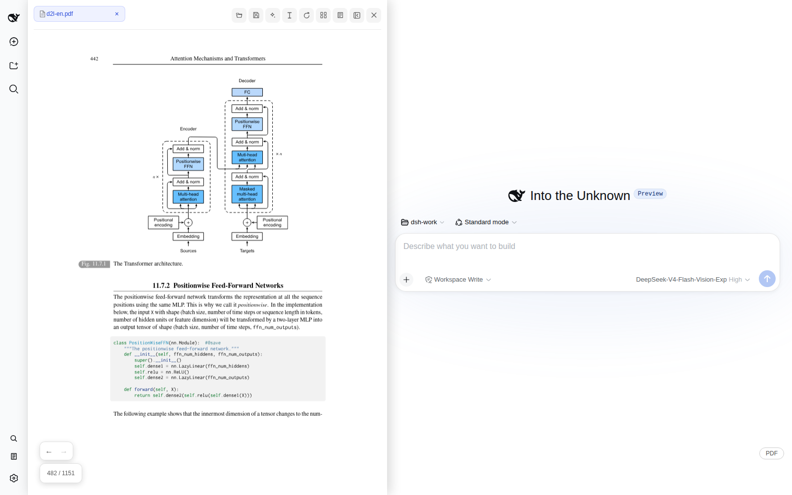
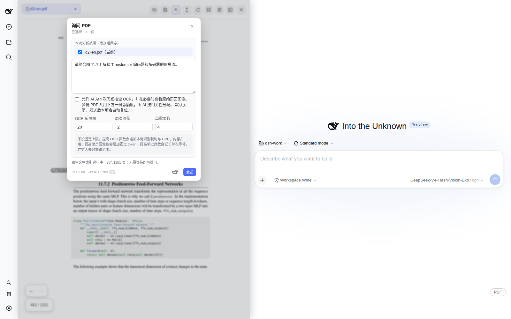
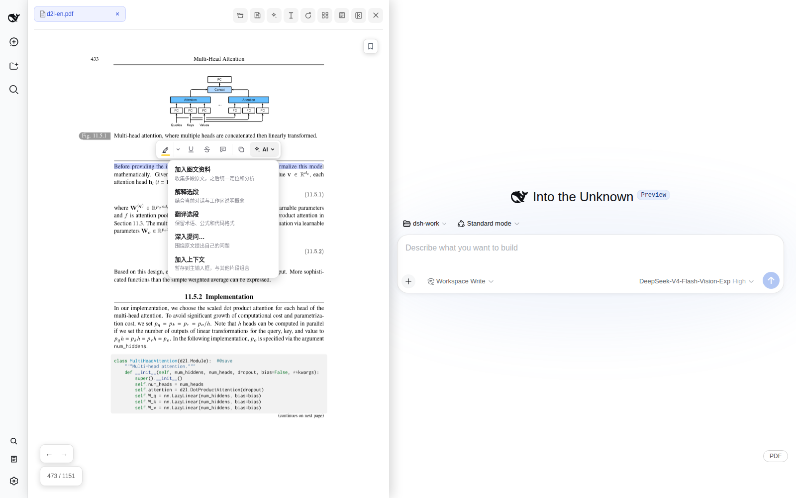
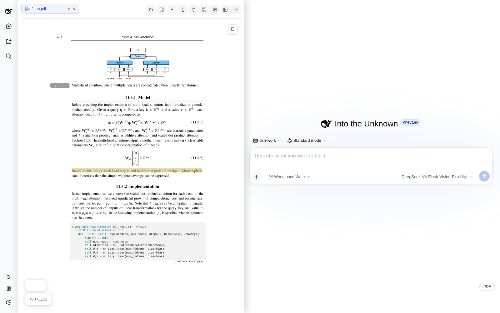
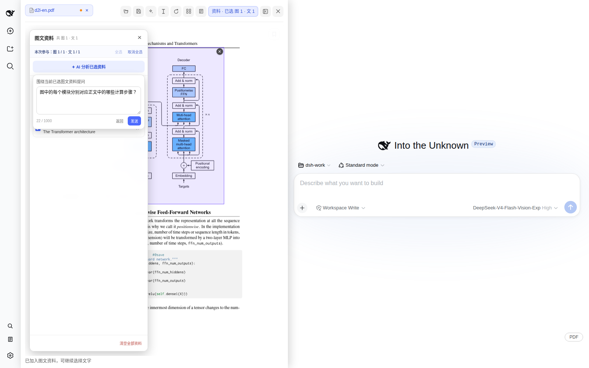

# dsh-pdf-reader

简体中文 | [English](README.en.md)

DeepSeek Harness 的外部（out-of-tree）PDF 阅读器插件，把阅读、批注和 AI 分析放在同一个 Web 工作流中。它支持原生文字、图片区域、图文资料、多 PDF 联合提问和用户授权后的按需 OCR。

> **发布状态：Beta。** 当前版本面向 DeepSeek Harness `0.1.1-rc.2`。建议先在非关键 PDF 副本上验证保存结果。

<p align="center">
  
</p>

<p align="center"><sub>在对话旁阅读技术文档：页面、批注、图文资料和 AI 都留在同一个工作流中。</sub></p>

## 从阅读到 AI 分析

以下演示均使用开放教材 [Dive into Deep Learning](https://d2l.ai/d2l-en.pdf)。

### 围绕整份 PDF 提问

选择一份或多份 PDF 后直接提问；OCR 默认关闭，只有用户授权后 AI 才能按需识别少量相关页面。



### 选择文字并调用 AI

选中文字后可复制、解释、翻译、深入提问，或加入上下文和图文资料。



### 创建并保存批注

支持高亮、下划线、删除线和备注；只有用户选择“另存为”或确认“覆盖原文件”时才写入 PDF。



### 组合图片与原文提问

把图表、图注和相关段落加入共享图文资料，统一分析并通过回答中的来源链接返回原页。



### 演示资料与授权

截图中的教材内容来自 Aston Zhang、Zachary C. Lipton、Mu Li 和 Alexander J. Smola 的 *Dive into Deep Learning*（[官方网站](https://d2l.ai/) / [PDF](https://d2l.ai/d2l-en.pdf) / [源码与许可证](https://github.com/d2l-ai/d2l-en/blob/master/LICENSE)），采用 [CC BY-SA 4.0](https://creativecommons.org/licenses/by-sa/4.0/) 许可。仓库不分发教材 PDF；`docs/images/readme/` 中包含教材页面内容的演示截图按 CC BY-SA 4.0 署名共享，插件源码及不含教材内容的界面代码仍采用 MIT License。

## 核心能力

- **阅读与导航**：多 PDF 标签、目录、书签、缩略图、全文搜索、跳转历史、缩放、适配和无损旋转
- **文字与批注**：原生文字选择、复制与 AI 操作，以及高亮、下划线、删除线、备注和批注中心
- **图文 AI**：图片区域提问、图文资料篮、多 PDF 共享资料、联合分析和可点击来源回链
- **整份文档问答**：单份或多份 PDF 联合提问，固定本次文档范围，并按来源区分事实与推断
- **按需 OCR**：默认关闭；用户明确授权后由 AI 选择必要页面，预算可配置且不会自动扫描整本
- **保存与恢复**：按对话恢复已打开文档和阅读状态，支持“另存为”及确认后覆盖原文件
- **长文档资源控制**：页面、Canvas、缩略图和索引采用有界或惰性处理；OCR 页面缓存限制为约 64 MiB 或 512 页

源码分工见 [src/README.md](src/README.md)。

## 运行要求

- DeepSeek Harness `0.1.1-rc.2`
- Node.js `^22.19.0` 或 `>=24.0.0`
- pnpm `>=11`
- 支持 IndexedDB、Web Worker、Canvas 和 Blob URL 的现代 Chromium 浏览器
- “覆盖原文件”需要 File System Access API；图片分析需要当前模型支持视觉输入；OCR 首次使用需要联网下载模型

## 安装

推荐从 GitHub Releases 下载构建好的 `.tgz`，然后在 DeepSeek Harness checkout 根目录执行：

```sh
pnpm dsh plugin --profile web add /absolute/path/to/dsh-pdf-reader-0.1.0-beta.3.tgz
pnpm dsh --profile web --dump-config | rg dsh-pdf-reader
pnpm dsh web
```

也可以从源码构建：

```sh
pnpm install --frozen-lockfile
pnpm build
```

随后在 DeepSeek Harness checkout 根目录安装源码目录：

```sh
pnpm dsh plugin --profile web add /absolute/path/to/dsh-pdf-reader
pnpm dsh --profile web --dump-config | rg dsh-pdf-reader
pnpm dsh web
```

包声明的 `dsh.bundle` 会自动把插件加入 profile，无需修改 Harness 源码或手工编辑 profile patch。卸载命令：

```sh
pnpm dsh plugin --profile web remove dsh-pdf-reader
```

## 数据与隐私

- PDF、阅读状态、未保存批注、书签和图文资料保存在当前站点的浏览器本地存储中；插件不提供独立遥测
- 只有用户明确调用 AI 功能时，相应文字、批注、图片或经授权读取的页面内容才会进入当前 Harness 会话及其模型服务
- OCR 在浏览器本机运行且默认关闭；普通阅读、旋转、搜索和批注不会自动上传或改写 PDF
- “覆盖原文件”仅在持有原生文件句柄、文件未被外部修改且用户再次确认后执行

PDF 内容、批注文字和图片都按不可信资料处理，不会被插件当作系统指令执行。安全问题请参阅 [SECURITY.md](SECURITY.md)。

## 开发与验证

```sh
pnpm install
pnpm verify       # TypeScript + Node 边界测试
pnpm build        # 正式构建
pnpm check        # verify + build
pnpm watch        # 增量构建
```

`pnpm pack` 会先执行正式构建。在内存受限设备上优先运行 `pnpm verify`，把完整构建交给 GitHub Actions 或资源充足的发布环境。常规 CI 会在 Node 24 验证正式 bundle；`Harness browser compatibility smoke` 工作流每周运行，也可手动触发。

本地 UI 回归可运行 `scripts/debug-wide.mjs`。重新生成 README 截图时，下载 [D2L PDF](https://d2l.ai/d2l-en.pdf)，启动本地 Harness 后执行：

```sh
D2L_PDF=/absolute/path/to/d2l-en.pdf node scripts/capture-readme.mjs
```

该脚本只填写演示问题，不会发送模型请求。

## 已知限制

- 图片区域选框不能跨页
- 目录和侧栏搜索只读取 PDF 自带信息，不会自动触发 OCR
- 首次 OCR 需要下载 PaddleOCR 模型；离线且无缓存时会失败
- 300 MiB 是文件入口的防御上限，不代表已承诺的大文件性能指标
- 需要视觉模型才能分析图片区域
- 插件不修改或要求定制 DeepSeek Harness 源码

## 许可证

项目源码采用 [MIT License](LICENSE)。随发布包内置的第三方运行时、字体、CMap 和 WASM 数据继续适用各自许可证，详见 [THIRD_PARTY_NOTICES.md](THIRD_PARTY_NOTICES.md) 和 [LICENSES](LICENSES/)。
